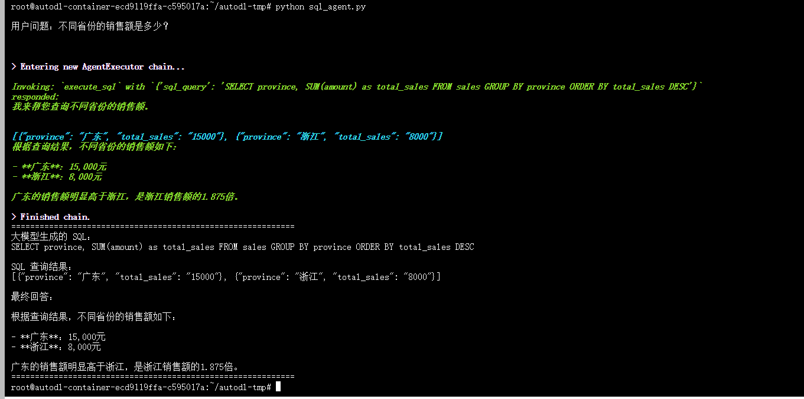
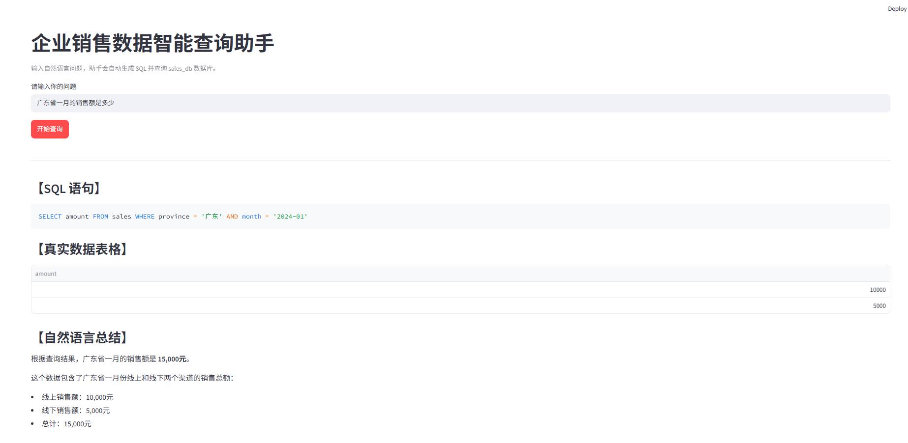

## 📌 项目简介
面向企业销售数据场景，基于 Text-to-SQL 技术与 MCP 协议构建的智能查询 Agent，实现自然语言生成 SQL、安全校验、数据回显及自然语言总结的完整闭环。

## 🏗️ 效果展示

 

## 🛠️ 技术栈
- **框架**：LangChain, Streamlit
- **大模型**：智谱 GLM-4
- **协议**：MCP (FastMCP)
- **数据库**：MySQL / SQLite

## 💡 核心实现
1. **Schema 注入与 Few-Shot**：动态注入表结构与示例数据，提升 SQL 生成准确率。
2. **安全拦截机制**：代码层强校验 SQL，强制拦截 DROP/DELETE 等危险操作防注入。
3. **Self-Reflection 自我纠错**：捕获 SQL 执行报错，重写 Error Message 反馈给大模型进行自我修正。
4. **MCP 协议封装**：基于 `@mcp.tool()` 将查询逻辑封装为标准工具，通过 `stdio` 通信实现解耦。

## ⚙️ 数据库配置
1. 导入 `sales_db_backup.sql` 到本地数据库。
2. 运行 `web_app.py` 即可启动前端。
